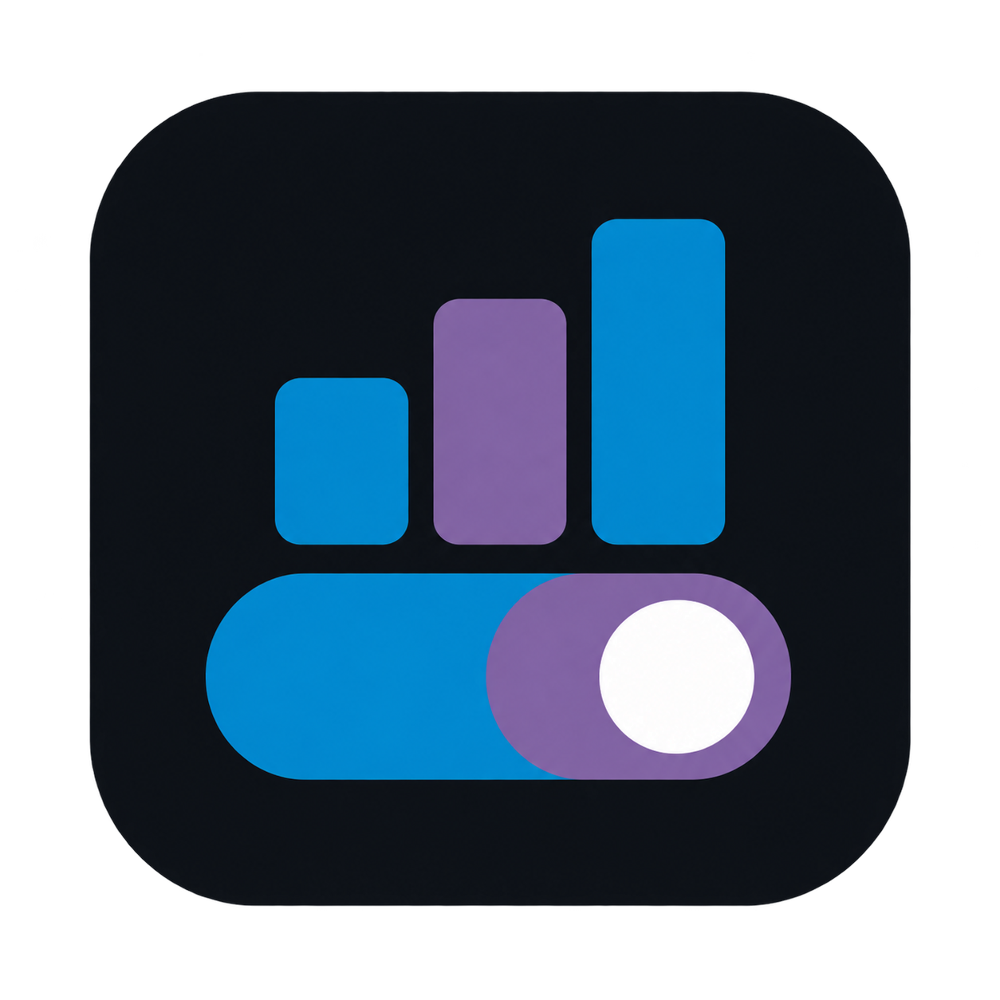
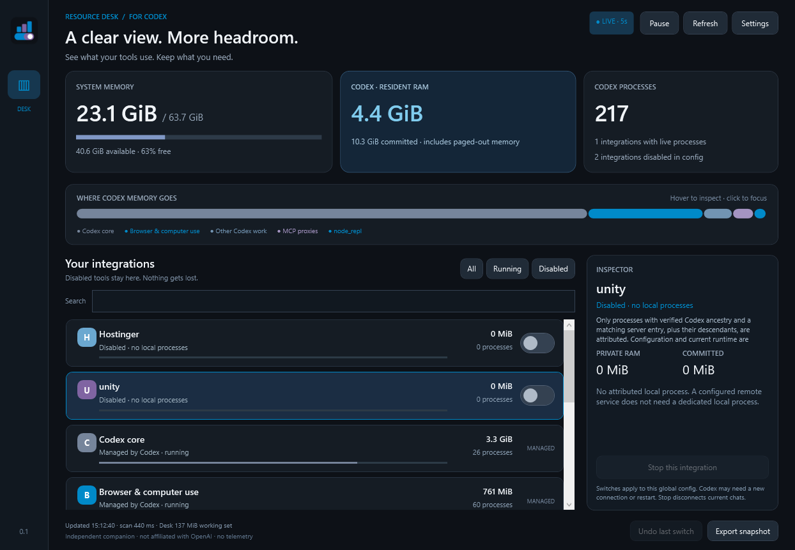

# Resource Desk for Codex



A small, native Windows companion for seeing where Codex memory goes and switching configured local MCP integrations on or off.

**0.1.1 — early preview.** Independent software; not affiliated with OpenAI. No telemetry, background service, browser server, administrator prompt or automatic startup entry.

[Download the Windows x64 portable preview](https://github.com/Kiragroh/codex-resource-desk/releases/tag/v0.1.1) · [Report an issue](https://github.com/Kiragroh/codex-resource-desk/issues) · [MIT license](LICENSE)



*Actual app capture from one workstation, 13 October 2026. A point-in-time view, not a benchmark or a claim about typical Codex usage. The separate [demo screenshot](docs/images/demo.png) uses clearly labelled simulated data.*

## Run the portable app

Extract the entire Windows x64 ZIP into a writable local folder, then open **ResourceDesk.exe**. Keep the bundled files together. The .NET runtime is included; no installation is needed. Close the window to stop monitoring.

The English interface uses blue `#008AC9` with purple `#8064A2` accents. It opens in read-only monitoring mode: configuration edits and process termination require your explicit interaction.

## Your first test

1. Select a configured local MCP integration you want to pause. Check its process count and private resident RAM in the inspector.
2. Switch it off. The confirmation offers **Also stop … verified processes now**. Stopping disconnects that integration from active chats.
3. Check that its configuration reads **Disabled** and whether its process count reaches zero.
4. To restore it, switch it on. This changes configuration; Codex starts the server on a subsequent connection. Existing Codex hosts may retain old settings. A new chat or a Codex restart after ongoing work finishes may be needed.

Disabled integrations remain listed, including Hostinger. Configured Hostinger entries are grouped into one switch. **Disabled · processes still running** is a meaningful state: turning off configuration and terminating an existing process are different actions. **Stop this integration** does only the latter; an enabled or stale host can start it again. Resource Desk does not run a kill loop.

## Reading the dashboard

- **System memory:** total physical RAM, used and available. Hover for system commit and kernel pools.
- **Codex resident RAM:** private resident pages in the verified Codex process tree. Shared pages are excluded, so this is a conservative attributable amount, not all physical memory touched by Codex.
- **Committed:** private committed bytes, which can include paged-out memory. Do not add this number to resident RAM.
- **Processes:** verified Codex roots and descendants, assigned to exactly one group. The inspector shows PID, age and private RAM.
- **Breakdown:** hover for RAM and count; click a segment or legend entry to select its group.
- **Pause:** freezes automatic five-second refresh, not Codex or any integration. Refresh samples manually.

Configured integrations appear first, then protected/shared helpers. Many processes can be legitimate: independent Codex sessions may each have their own MCP connection, runtime, proxy or browser. Multiplicity alone does not prove a memory leak or that a project is unused.

## Configuration and safeguards

By default the app reads `config.toml` under `CODEX_HOME`, or `%USERPROFILE%\.codex`. **Settings** selects another file. Only explicit global `[mcp_servers.name]` sections with supported local configurations are editable. Unsupported TOML layouts are refused rather than rewritten. Remote, protected, ambiguous and built-in helpers are read-only in this preview.

Every switch preserves comments and unrelated settings, validates TOML and semantic changes, checks the displayed file version, and creates an adjacent `.resourcedesk.*.bak` backup. **Undo last switch** works within this app session only while both current config and backup still match. It does not restart processes. Backups may contain credentials: keep them private.

Writes by cooperating Resource Desk instances are serialized. External atomic writers cannot be locked out completely: if one races replacement, its displaced bytes are retained in the backup and a conflict is reported. Reconcile the backup before editing again. No automatic recovery overwrites another version.

Stopping rechecks the live configuration, ancestry, selected group, creation time and executable identity. It binds termination to an exact Windows process handle. Uncertain processes remain running. Core, Node REPL, shared browser helpers and unattributed work cannot be stopped here.

## Preview boundaries

- Windows x64 only; tested on the author's Windows machine. The executable is unsigned.
- Global MCP configuration only. Project overrides, plugins, managed policy and remote-machine resources are not comprehensively inventoried or controlled.
- Codex detection currently recognizes the standard Windows OpenAI Codex install locations. Other layouts and orphaned/reparented helpers can be omitted. Unknown descendants remain in **Other Codex work**, read-only.
- No CPU/GPU profiler, process suspension, Windows startup manager, budget enforcement or automatic idle shutdown in this version.
- A saved switch is not proof that every already-running Codex host has reloaded it. The live count remains the check.
- Automated verification uses temporary configs and synthetic process trees. Startup and live sampling have been exercised. Current workstation snapshots show Unity and Hostinger disabled with zero attributed processes; this is not a cross-machine lifecycle guarantee.

## Privacy

Monitoring stays local. Command lines and executable paths are read in memory to identify processes; they are not displayed or included in snapshot exports. Exports contain integration names and aggregate measurements, with no credentials, paths, command lines, hostnames or document titles. Review names before sharing. The app has no networking code and does not launch server commands itself.

## Build and verify

Requires .NET 10 SDK on Windows for building, not for running the portable package.

```powershell
dotnet run --project tests/ResourceDesk.Tests -c Release
dotnet run --project tests/ResourceDesk.Tests -c Release -- --sample
dotnet build src/ResourceDesk.App/ResourceDesk.App.csproj -c Release
dotnet publish src/ResourceDesk.App/ResourceDesk.App.csproj -c Release -r win-x64 --self-contained true -o artifacts/ResourceDesk-0.1.1-win-x64
```

The fixture suite covers TOML round trips, comments and quoted keys, protected entries, stale versions, backup tampering, process ancestry, PID reuse, ambiguous attribution and stop authorization. `--sample` reads the live machine without modifying integrations. App options: `--demo` for clearly labelled simulated read-only data; `--config <path>` to choose a config; `--screenshot <png>` to render the app's own window and exit without mutations.

Feedback and reproducible bug reports are welcome. Review snapshots before posting them; never attach your raw Codex configuration or its backups.
